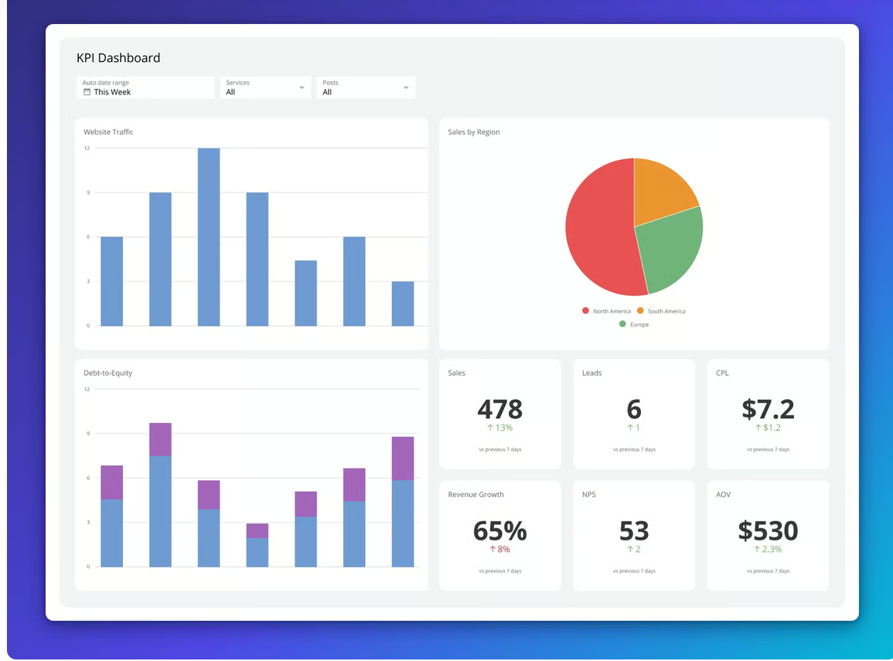

# Skills Test Build: Dashboard & App Boilerplate (Build Brief for Claude Code)

> **What this file is.** This is mainly a **test of the installed Claude Code skills**.
> The four team plugins listed in `docs/claude-skills.md` (25 skills) are used on a
> realistic build from **an empty folder**. The thing being built is a reusable
> starter template (boilerplate) for future dashboards and frontend apps, plus one
> example dashboard that recreates the reference mockup.
>
> The build runs **once**, using **only those skills** (§0). Every phase is timed.
> At the end, Claude writes a **skills review**: for each skill, the top 5 pros, the
> top 5 cons, and an estimate of the time it saved or cost. The review is based on
> what happened in the build; no second build is run for comparison.
>
> **Folder layout before the build starts** (already prepared):
> ```
> dashboard-app-template/
> ├─ .claude/settings.json                # enables the 4 team plugins + session-start check
> ├─ .claude/scripts/install-plugins.mjs  # installs any missing team plugin
> └─ docs/
>    ├─ claude-skills.md                  # what each of the 25 skills does
>    └─ specs/
>       ├─ 2026-11-24-boilerplate-design.md   (this file)
>       └─ reference-mockup.png
> ```
>
> **How to start**
> 1. Open a terminal in `dashboard-app-template` and run `claude`. Accept the "trust this folder" prompt.
> 2. If the session-start message lists missing plugins, run `node .claude/scripts/install-plugins.mjs install`, then restart Claude Code.
> 3. Check that `/plugin` → Installed shows `superpowers`, `frontend-design`, `ui-ux-pro-max` and `modern-web-guidance` as enabled. `ui-ux-pro-max` also needs Python 3.
> 4. Paste the kickoff prompt in **§11**.
>
> This file is the approved design, so Claude skips brainstorming.

## Reference mockup: the example dashboard must look like this



The **light-gray panel and everything inside it** is the app. The purple-to-cyan
gradient and the white frame around it are just how the screenshot was presented,
so they are not part of the app. §5 and §6 turn this image into exact colors,
sizes and data. When the text and the image disagree, the image wins. The one
exception is listed in §6 under *The one deliberate deviation*.

---

## 0. The skills under test

**Rules**
- **Use only skills from these four plugins:** `superpowers`, `frontend-design`, `ui-ux-pro-max`, `modern-web-guidance`.
- **Don't use any other skill:** no other plugin, claude.ai account skill, or MCP-provided skill.
  - If one triggers on its own, don't follow it, and log a `note` saying which one.
  - Claude Code's built-in commands are fine (e.g. `/cost`), but log them too.
- **Phase 0 checks the setup:** record the output of `claude plugin list` and `python --version` in `docs/build-log/REPORT.md`.
  - If any of the four plugins is missing or disabled, **stop and tell the user**. Don't build without it.
  - If other plugins with skills are enabled, list them in the report and leave them unused.
- **Invoke each skill explicitly** (`/plugin:skill`) in the phase the table below assigns it, so its effect can be attributed.
  - If a skill turns out not to fit, log a `note` with the reason instead of quietly skipping it.

**Coverage: all 25 skills**

| Plugin | Skill | Used in phase | Why / why not |
|---|---|---|---|
| superpowers | `using-superpowers` | every session (loads automatically) | measures the session-start overhead |
| superpowers | `brainstorming` | — not used | the spec is already approved; running it would only re-ask settled questions |
| superpowers | `writing-plans` | 1 | turns this spec into a task plan |
| superpowers | `using-git-worktrees` | 2 → 3 | after the scaffold commit on `main`, phases 3–9 run on branch `feat/boilerplate` in a worktree |
| superpowers | `subagent-driven-development` | 3 | the five `lib/` engine modules are independent tasks, each with a review |
| superpowers | `dispatching-parallel-agents` | 5 | the independent components (charts, `KpiTile`, `FilterBar`, states) are built in parallel |
| superpowers | `executing-plans` | 4, 6, 7 | inline execution where tasks depend on each other |
| superpowers | `test-driven-development` | 3, 6 | engine and KPI logic, written test-first |
| superpowers | `systematic-debugging` | whenever something breaks | find the cause before fixing |
| superpowers | `verification-before-completion` | every gate (§8) + 8 | evidence before claiming a phase is done |
| superpowers | `requesting-code-review` | 9 | review against the §1 anti-goals |
| superpowers | `receiving-code-review` | 9 | act on the review critically |
| superpowers | `finishing-a-development-branch` | 10 | merge `feat/boilerplate` back to `main` |
| superpowers | `diagnosing-superpowers` | 11 | analyse this build session as evidence for the skills review |
| superpowers | `writing-skills` | — not used | no skill is being written |
| frontend-design | `frontend-design` | 4 | implements the mockup's look precisely (§5), with no redesign |
| ui-ux-pro-max | `ui-styling` | 2, 5 | shadcn/ui + Tailwind setup and components |
| ui-ux-pro-max | `design-system` | 4 | tokens: primitive → semantic → component (§5) |
| ui-ux-pro-max | `ui-ux-pro-max` | 5, 6 | UX-rule check of components and the dashboard (uses Python search) |
| ui-ux-pro-max | `design` | 7, only if an image API key is set | app icon / favicon; otherwise log "skipped: no key" |
| ui-ux-pro-max | `brand` | — not used | the template has no brand of its own; the look comes from the mockup |
| ui-ux-pro-max | `banner-design` | — not used | no banners in scope |
| ui-ux-pro-max | `slides` | — not used | no presentation in scope |
| modern-web-guidance | `modern-web-guidance` | 5, 6 | accessible controls, hidden data tables, responsive layout, performance |
| modern-web-guidance | `chrome-extensions` | — not used | not a browser extension |

---

## 1. What we're building

There are three parts, and they are kept strictly separate:

| Part | Where it lives | Kept when you start a new app? |
|---|---|---|
| **Boilerplate core:** app shell, routing, theming/tokens, data-source layer, metrics engine, chart + dashboard components, testing, CI, `CLAUDE.md` | `src/app`, `src/components`, `src/lib`, `src/styles`, root config | ✅ Yes. This is the product. |
| **Example dashboard:** a KPI dashboard on seeded dummy data that uses every core piece | `src/features/example-dashboard/` | ❌ Deleted (one folder + one route line) |
| **Build log & skills review:** per-phase timings, plus the post-build review of each skill | `docs/build-log/`, `scripts/timelog.*` | ✅ Kept. Future features keep logging into it. |

**Goals**
- **Primary goal:** exercise the installed skills (§0) on a realistic build from an empty folder, and produce honest evidence of what each one is worth.
- The example dashboard is a **close visual match to the reference mockup**: same layout, colors, type, chart forms and numbers in the default view.
- `git clone` the template, then `npm i && npm run dev`, gives a working app in under a minute. Its default look is the mockup's style.
- A **new dashboard** is a new folder in `src/features/` plus one route. It needs no changes to the core.
- Switching from dummy data to a real API means writing one adapter file, with no component changes.
- KPI deltas, date periods and formats come from one tested engine, never computed ad hoc inside a component.
- Light and dark mode, accessible, and responsive from 375 px to 1440 px+.
- Every build phase is timed with real clock timestamps, and the skills used in it are recorded.
- After the build, a skills review (§9) says which skills to keep using for future apps, and why.

**Non-goals:** a backend, auth, SSR, i18n, a component-library npm package, or Storybook. Storybook can be added later.

**Anti-goals (a failure even if it "works")**
- Example-dashboard code leaking into `src/lib` or `src/components`. The core must never import from `features/`.
- A KPI delta that is green when the metric got worse. Every metric declares `higherIsBetter`.
- The example dashboard drifting from the mockup: different layout, rounded "modern" restyling, added header chrome, or different chart types.
- A dual-axis chart, or values readable only on hover (a visually hidden table gives screen readers the same data; see §4).
- Durations in the build log that were estimated or remembered instead of measured from timestamps.
- Using a skill from outside the four team plugins, or skipping an assigned skill without logging why.
- A skills review that reads like marketing: generic pros, no cons, or time savings stated as fact instead of labeled estimates.

---

## 2. Top 3 stacks for a dashboard/app boilerplate

| | **A. Vite SPA + shadcn/ui (recommended)** | B. Next.js + shadcn/ui | C. Vite + CSS Modules + ECharts |
|---|---|---|---|
| Core | Vite · React · TS · Tailwind v4 · shadcn/ui · Recharts · React Router · TanStack Query | Next.js App Router · same UI layer · TanStack Query | Vite · React · TS · CSS Modules with CSS-variable tokens · ECharts · React Router |
| `ui-ux-pro-max:ui-styling` (shadcn + Tailwind) | ✅ | ✅ | ❌ |
| `ui-ux-pro-max:design-system` | ✅ | ✅ | ✅ |
| `frontend-design`, `modern-web-guidance` | ✅ / ✅ | ✅ / ✅ (plus Next-specific rules) | ✅ / ✅ best fit |
| superpowers TDD / verification | ✅ Vitest, zero config | ⚠️ more config | ✅ |
| Good for future… | internal dashboards, admin panels, SaaS frontends that call an existing API | public, SEO-sensitive apps, or apps that need their own server routes | chart-heavy analytics (zoom, brush, 10k+ points) with no Tailwind |
| Cost | lowest | server/client boundaries and a heavier build | you hand-build every primitive; ECharts adds ~300 KB+ |

**Decision: Stack A.** Dashboards and internal apps are client-side apps that talk to an API. Every installed design skill applies to Stack A, and it is the fastest to iterate on.
If a future app needs SEO or server routes, that is a reason to start from Next.js instead. Note that in the app's own spec.

**Full stack (Stack A)**

| Concern | Choice | Why |
|---|---|---|
| Build/dev | Vite + React + TypeScript (strict) | Fast HMR, simple config |
| Styling | Tailwind v4 (`@tailwindcss/vite`) + CSS-variable tokens | Tokens are themeable per app |
| Components | shadcn/ui, copied into `src/components/ui` | You own the code, and `ui-styling` knows it |
| Charts | Recharts, wrapped by the core chart components | Apps never import Recharts directly, so the chart library can be swapped later |
| Routing | React Router | Multi-page apps; filters live in typed URL search params |
| Server state | TanStack Query | Caching, refetch, and "keep previous data" for free when a real API arrives |
| Validation | Zod | URL params and API responses are parsed, never trusted |
| Icons | lucide-react | Same icon set shadcn uses |
| Tests | Vitest + Testing Library; Playwright smoke test (1 spec) | Unit tests on the engine; one end-to-end test that the app boots and filters work |
| Quality | The linter the Vite template ships with, Prettier, `tsc --noEmit` | One `npm run check` runs everything |
| CI | GitHub Actions: `check` + `test` + `build` | Every future app inherits it |

---

## 3. Boilerplate architecture

```
.
├─ .claude/                      # team-plugin setup (present before the build; keep it)
├─ CLAUDE.md                     # conventions, skill map, time-logging rule (see Appendix)
├─ README.md                     # quick start + "start a new app from this template"
├─ docs/
│  ├─ claude-skills.md           # the 25 team skills (present before the build)
│  ├─ specs/                     # design docs (this file + reference-mockup.png go here)
│  └─ build-log/
│     ├─ timelog.csv             # raw timestamps (append-only)
│     ├─ REPORT.md               # generated per-phase durations & totals
│     └─ SKILLS-REVIEW.md        # post-build pros/cons + time estimates per skill (§9)
├─ scripts/
│  ├─ timelog.sh                 # append a start/end/note event (§9)
│  └─ timelog-report.mjs         # build REPORT.md from timelog.csv
├─ .github/workflows/ci.yml
└─ src/
   ├─ main.tsx
   ├─ app/                       # ── CORE ──
   │  ├─ providers.tsx           # QueryClient, ThemeProvider, Router, TooltipProvider
   │  ├─ routes.tsx              # route table. Features register here (1 line each); a route can set shell: false
   │  ├─ AppShell.tsx            # sidebar nav + header (title, theme toggle) + <Outlet/>. Skipped for routes with shell: false
   │  └─ nav.ts                  # nav items. Features add 1 entry
   ├─ components/
   │  ├─ ui/                     # shadcn primitives
   │  ├─ charts/                 # ChartCard, BarChart, StackedBarChart, PieChart, SegmentedBar, Sparkline, DataTableView
   │  └─ dashboard/              # DashboardPage, FilterBar, KpiGrid, KpiTile, EmptyState, ErrorState
   ├─ lib/
   │  ├─ metrics/                # defineMetric, computeKpi, delta, sentiment (tested)
   │  ├─ dates/                  # range presets, previousPeriod, bucketing (tested)
   │  ├─ format/                 # compact number, currency, percent, pp (tested)
   │  ├─ data/                   # DataSource<T> interface, createMockSource, createHttpSource, seeded PRNG
   │  ├─ url-state/              # useUrlState(zodSchema) → typed, shareable filter state
   │  └─ theme/                  # theme toggle + persistence
   ├─ styles/
   │  ├─ tokens.css              # design tokens, light + dark (§5)
   │  └─ index.css
   └─ features/                  # ── APPS LIVE HERE ──
      └─ example-dashboard/      # delete this folder when starting a real app
         ├─ data/fixture.ts      # the mockup's exact numbers (default view)
         ├─ data/generate.ts     # seeded variations for other filter combinations
         ├─ data/source.ts       # createMockSource(...), the only data entry point
         ├─ metrics.ts           # the six KPI definitions (uses lib/metrics)
         ├─ filters.ts           # zod schema for this dashboard's URL filters
         ├─ components/          # TrafficCard, RegionCard, DebtEquityCard
         └─ route.tsx            # shell: false, so it renders exactly like the mockup
```

**Dependency rule (enforced by a lint rule or a test):** `features/*` → `components/*` → `lib/*`.
`lib` imports nothing from the app. Nothing outside `features/` imports from `features/`.

**Extension points:** how a future app uses the template. Put these steps in the README.
1. Use the repo as a GitHub template, or copy it.
2. Delete `src/features/example-dashboard/` and its line in `routes.tsx` and `nav.ts`.
3. Create `src/features/<your-app>/`. Define its metrics with `defineMetric`, its filters with a Zod schema, and its data with `createMockSource` (now) or `createHttpSource` (later).
4. Adjust the brand by editing `styles/tokens.css` only.
5. Write the app's spec in `docs/specs/` and keep logging time (see `CLAUDE.md`).

---

## 4. Core module contracts

**`lib/metrics`**: the reusable KPI engine.
```ts
type DeltaMode = 'percent' | 'absolute' | 'points';
interface MetricDef<Row> {
  id: string; label: string;
  compute: (rows: Row[]) => number | null;   // null = not computable (e.g. ÷0)
  format: (v: number) => string;
  deltaMode: DeltaMode;
  higherIsBetter: boolean;
  flatThreshold?: number;                    // default 0.005 (0.5%)
}
interface KpiResult {
  id: string; label: string; value: string;
  delta: string | null;                      // "+13%", "+$1.20", "+8 pp", or null → "—"
  direction: 'up' | 'down' | 'flat';
  sentiment: 'good' | 'bad' | 'neutral';     // direction × higherIsBetter
  comparisonLabel: string;                   // "vs previous 7 days"
  srText: string;                            // "up 13%, better than previous 7 days"
  sparkline: number[];
}
defineMetric<Row>(def): MetricDef<Row>
computeKpis<Row>(defs, current: Row[], previous: Row[], ctx): KpiResult[]          // from raw rows
compareValues(defs, current: Record<id, number>, previous: Record<id, number>, ctx): KpiResult[]  // from pre-aggregated values (APIs often return these)
```

**`lib/dates`**
- `resolvePreset('7d' | '30d' | '90d' | 'mtd' | 'qtd', today)` returns `{start, end}`.
- `previousPeriod(range)` returns a range of equal length ending the day before `start`.
- `bucketFor(range)` returns `'day'` up to 45 days, otherwise `'week'`.

**`lib/data`**
```ts
interface DataSource<Q, R> { get(query: Q, signal?: AbortSignal): Promise<R> }
createMockSource(fn, { latencyMs: [250, 400] })   // fake latency so loading states get built
createHttpSource(url, zodSchema)                  // parses responses, throws typed errors
mulberry32(seed)                                  // deterministic PRNG for dummy data
```
Features call sources through TanStack Query with `placeholderData: keepPreviousData`.

**`lib/url-state`**: `useUrlState(schema)` returns `[state, setState, reset]`. Invalid params fall back to schema defaults and are never thrown.

**`components/dashboard`**
- `DashboardPage` (title, `FilterBar` slot, `KpiGrid`, card grid; loading/empty/error built in).
- `KpiTile` renders a `KpiResult` and never computes anything.
- `FilterBar` takes filter definitions (preset range plus N select dimensions).

**`components/charts`**
- Every chart takes `{ data, series: {key, label, colorSlot}[] }` and renders inside a `ChartCard`.
- Every chart also renders its data as a **visually hidden `<table>`** (`DataTableView`, `sr-only`), so screen readers get the values without changing the look.
- `ChartCard` has an optional visible **Chart / Table** toggle (`showTableToggle`). It is off by default and off in the example, to match the mockup.
- `PieChart` (used in the example, as in the mockup) and `SegmentedBar` (an alternative for future apps) are both available for part-to-whole data.

---

## 5. Design tokens & chart rules (taken from the mockup; every future app inherits these)

All values below were sampled from `reference-mockup.png`. They are the template's **default theme**. A future app re-brands by editing `tokens.css` only.

**Surfaces and ink** (light; dark is derived, see *Theme*)

| Token | Value | Where in the mockup |
|---|---|---|
| `--page` | `#f3f5f4` | the light-gray panel behind the cards |
| `--card` | `#ffffff` | every card and every filter box |
| `--card-radius` | `6px` | cards and filter boxes |
| `--card-border` | none (a very faint shadow at most: `0 1px 2px rgb(0 0 0 / 0.04)`) | cards sit flat on the gray panel |
| `--ink-strong` | `#1f2120` | page title, big KPI numbers |
| `--ink` | `#2b2d2c` | filter values ("This Week", "All") |
| `--ink-muted` | `#6b6b6b` | card titles ("Website Traffic") |
| `--ink-faint` | `#8e9190` | filter labels, KPI labels, "vs previous 7 days", legend text |
| `--axis` | `#9a9a9a` | axis tick labels |
| `--grid` | `#eeeeee` | solid horizontal gridlines |

**Series colors** (fixed slots, mapped to shadcn `--chart-1…5`)

| Slot | Color | Used for in the mockup |
|---|---|---|
| 1 | `#6e9bd2` (soft blue) | Website Traffic bars; Debt-to-Equity bottom segment |
| 2 | `#e85253` (coral red) | Sales by Region: North America |
| 3 | `#eb952e` (orange) | Sales by Region: South America |
| 4 | `#70b479` (green) | Sales by Region: Europe |
| 5 | `#a365b9` (purple) | Debt-to-Equity top segment |

**Delta colors** (separate from series colors)

| Role | Value | Note |
|---|---|---|
| good | `#5b9f52` | the mockup's green. Darken it slightly, keeping the hue, only if needed to reach 4.5:1 contrast on white |
| bad | `#b3426b` | the mockup's crimson. Same contrast rule |
| neutral | `--ink-faint` | |

- The arrow is a thin `↑` / `↓` character before the value, as in the mockup (`↑ 13%`).
- `srText` carries the meaning for screen readers.

**Type**
- **Open Sans** for everything (self-host via `@fontsource/open-sans`), falling back to the system sans.
- Use regular and semibold weights only.

| Element | Size | Weight | Color |
|---|---|---|---|
| Page title "KPI Dashboard" | 20px | 400 | `--ink-strong` |
| Filter label ("Auto date range") | 10px | 400 | `--ink-faint` |
| Filter value ("This Week") | 12px | 400 | `--ink` |
| Card title ("Website Traffic") | 11px | 400 | `--ink-muted` |
| Axis ticks / legend | 9–10px | 400 | `--axis` / `--ink-faint` |
| KPI label ("Sales") | 11px | 400 | `--ink-faint` |
| KPI value ("478") | 36px | 600 | `--ink-strong` (proportional figures) |
| KPI delta ("↑ 13%") | 12px | 400 | good / bad / neutral |
| KPI footnote ("vs previous 7 days") | 8–9px | 400 | `--ink-faint` |

**Chart rules** (match the mockup)
- **Bars:** square ends with no rounding. Bar width is about 60% of the category slot, and there are no borders.
- **Stacked bars:** slot 1 at the bottom and slot 5 on top. Segments touch, with no gap, as in the mockup.
- **Gridlines:** solid 1px `--grid` lines, horizontal only. The y-axis has 5 ticks (0, 3, 6, 9, 12 in the default view).
  - No axis lines, no x-axis labels, no vertical gridlines.
- **Pie:** a full pie (not a donut) that starts at 12 o'clock and runs clockwise, with no slice borders.
  - The legend sits under the pie, centered: colored dots + labels, wrapping to two lines as in the mockup.
- **Tooltips** appear on hover, styled as a white card with a faint shadow.
- Every chart also renders its hidden data table (§4).
- No dual axes. A color follows its entity, so a filter change never recolors a series.

**Layout tokens:** page padding `20px` · gap between cards `12px` horizontally (`16px` between KPI tiles) and `12px` vertically · card padding `12px`.

**Theme**
- Light (the mockup) is the default.
- Dark mode is supported through `prefers-color-scheme` and a `data-theme` override, saved in localStorage inside try/catch.
- Derive dark from the same roles: page `#141516`, card `#1d1f20`, ink `#ecedec` / `#b5b8b7` / `#8a8d8c`, grid `#2a2c2d`. Use the same series hues, about 8% lighter.
- **There is no visible theme toggle on the example dashboard** (the mockup has none). The toggle lives in the `AppShell` header used by future apps.

**States**
- First load shows skeleton blocks the same size as the cards.
- A refetch keeps the previous render at ~60% opacity with no layout jump.
- Empty results show a message and a "Reset filters" button.
- Errors show a message and a "Retry" button.
- Respect `prefers-reduced-motion`.

`frontend-design` / `design-system` / `ui-styling` must **implement this look, not redesign it**. Use them for structure, tokens and code quality, not for a new aesthetic.

---

## 6. Example dashboard spec: recreate the mockup (`features/example-dashboard`)

### Layout (measured from the mockup; the panel is ~1017 px wide)
```
┌ page (#f3f5f4, padding 20) ─────────────────────────────────────────────────┐
│ KPI Dashboard                                                               │
│ ┌Auto date range──┐ ┌Services──────┐ ┌Posts─────────┐                       │
│ │📅 This Week      │ │All         ▾ │ │All         ▾ │   ← white boxes, 30px tall │
│ └─────────────────┘ └──────────────┘ └──────────────┘     widths ≈178/118/128 │
│ ┌ Website Traffic ───────────────┐ ┌ Sales by Region ──────────────────────┐ │
│ │ bars, y 0–12                    │ │          ● pie ●                       │ │
│ │                    (≈457 wide)  │ │ ● North America ● South America        │ │
│ │                    (≈300 tall)  │ │          ● Europe          (≈504 wide) │ │
│ └─────────────────────────────────┘ └───────────────────────────────────────┘ │
│ ┌ Debt-to-Equity ─────────────────┐ ┌Sales────┐ ┌Leads────┐ ┌CPL──────┐      │
│ │ stacked bars, y 0–12            │ │  478    │ │   6     │ │ $7.2    │      │
│ │                                 │ │ ↑ 13%   │ │ ↑ 1     │ │ ↑ $1.2  │      │
│ │                                 │ └─────────┘ └─────────┘ └─────────┘      │
│ │                                 │ ┌Revenue G┐ ┌NPS──────┐ ┌AOV──────┐      │
│ │                                 │ │  65%    │ │  53     │ │ $530    │      │
│ │                                 │ │ ↑ 8%    │ │ ↑ 2     │ │ ↑ 2.3%  │      │
│ └─────────────────────────────────┘ └─────────┘ └─────────┘ └─────────┘      │
└──────────────────────────────────────────────────────────────────────────────┘
```
- **Grid:** two columns at a ratio of about **0.9fr : 1fr** (457 : 504 px) and two rows of equal height (~300 px each).
- **Bottom-right** is a nested 3 × 2 grid of KPI tiles, each ≈157 × 142 px.
- **KPI tiles:** the label is top-left. The value, delta and footnote are **centered**.
- **Filter boxes:** a small label on top and the value below it. The date box has a calendar icon; the other two have a ▾ caret on the right.
- The route uses `shell: false`, so there is no sidebar or extra header. The page is exactly the panel.
- **Responsive** (not in the mockup, so this is Claude's call): under 900 px the two columns stack, and the KPI grid stays 3 × 2. Under 480 px the KPI grid becomes 2 × 3.

### Data: the default view must show the mockup's numbers

`data/fixture.ts` holds the default view (**This Week / All services / All posts**), exactly as in the mockup:

| Card | Data |
|---|---|
| Website Traffic (7 bars) | `[6, 9, 12, 9, 4.4, 6, 3]` |
| Sales by Region | North America **54%**, South America **18%**, Europe **28%** (measured from the pie's angles) |
| Debt-to-Equity (7 stacks, bottom / top) | `[4.5/2.3, 7.5/2.2, 3.8/2.0, 1.9/1.0, 3.4/1.7, 4.4/2.2, 5.8/3.0]` |

| KPI | Current | Previous (gives the delta) | Shown as |
|---|---|---|---|
| Sales | 478 | 423 | `478` · `↑ 13%` |
| Leads | 6 | 5 | `6` · `↑ 1` |
| CPL | 7.2 | 6.0 | `$7.2` · `↑ $1.2` |
| Revenue Growth | 65 | 57 | `65%` · `↑ 8%` |
| NPS | 53 | 51 | `53` · `↑ 2` |
| AOV | 530 | 518 | `$530` · `↑ 2.3%` |

- The KPIs go through `compareValues` (§4), so the engine computes the deltas and their colors. Nothing is hard-coded in the tile.
- **Other filter combinations** come from `data/generate.ts`: seeded (`mulberry32`, keyed by the filter values) and deterministic variations of the fixture, ±10–40%, keeping the same shapes and number formats.
- Debt-to-Equity ignores the Services and Posts filters, because it is company-wide.

### Filters (URL params, Zod)

| Box label | Options | Default |
|---|---|---|
| Auto date range | This Week · Last Week · This Month · Last 30 Days · This Quarter | This Week |
| Services | All · Organic · Paid Search · Social · Email | All |
| Posts | All · Blog · Video · Case Study · Newsletter | All |

The footnote text follows the range, e.g. "vs previous 7 days" or "vs previous 30 days".

### KPI definitions

| KPI | Format | Delta format | higherIsBetter |
|---|---|---|---|
| Sales | integer | % | ✅ |
| Leads | integer | absolute | ✅ |
| CPL | `$` + 1 decimal | absolute `$` | ❌ |
| Revenue Growth | `%` | absolute (shown with `%`, as in the mockup) | ✅ |
| NPS | integer | absolute | ✅ |
| AOV | `$` integer | % | ✅ |

### The one deliberate deviation
The mockup colors **CPL ↑ $1.2 green** and **Revenue Growth ↑ 8% red**. Both are wrong: higher cost per lead is bad, and higher growth is good.
The template colors deltas by `higherIsBetter`, so in the default view **CPL's delta is red and Revenue Growth's is green**. Everything else matches the image.

---

## 7. Build phases

Each phase is one row. **Log `start` before the phase and `end` after it** (§9), and list the skills actually invoked in the `end` event's details.

| # | Phase | Skill(s) to use |
|---|---|---|
| 0 | **Setup check and timing.** Run the §0 checks (plugin list, Python). Create `scripts/timelog.sh` and log `run start`. | — |
| 1 | **Plan.** Turn this spec into an ordered task list, marking which tasks are independent (for phases 3 and 5). | `/superpowers:writing-plans` |
| 2 | **Scaffold from scratch** in this folder. <br>• `git init`. <br>• Create a Vite React + TypeScript app here with `npm create vite@latest` (react-ts template). If asked about existing files, choose to **keep** them, because `.claude/` and `docs/` must survive. <br>• Add Tailwind v4, shadcn init + primitives, React Router, TanStack Query, Zod, Vitest + Testing Library, Playwright, Prettier, and `npm run check`. <br>• Add `.claude/settings.local.json` and `.claude/team-plugins.local` to `.gitignore`. <br>• Commit on `main`. | `/ui-ux-pro-max:ui-styling` |
| 2→3 | Create branch `feat/boilerplate` in a worktree; phases 3–9 happen there. | `/superpowers:using-git-worktrees` |
| 3 | **Core engine, test-first:** `lib/dates`, `lib/format`, `lib/metrics`, `lib/data`, `lib/url-state`, one subagent task each. | `/superpowers:subagent-driven-development` + `/superpowers:test-driven-development` |
| 4 | **Tokens and theme** (§5), app shell, routing, nav. | `/ui-ux-pro-max:design-system` + `/frontend-design:frontend-design` + `/superpowers:executing-plans` |
| 5 | **Core components** in parallel: chart components, `KpiTile`, `FilterBar`, `DataTableView`, states. Then put them together in `DashboardPage`. | `/superpowers:dispatching-parallel-agents` + `/ui-ux-pro-max:ui-styling` + `/modern-web-guidance:modern-web-guidance` + `/ui-ux-pro-max:ui-ux-pro-max` |
| 6 | **Example dashboard** (§6), using only core APIs. Then the **mockup match loop**: <br>• take a Playwright screenshot of the default view at 1017 px wide <br>• look at it next to `reference-mockup.png` and list every visible difference <br>• fix them, and repeat until only §6's deliberate deviation is left | `/superpowers:test-driven-development` (metrics + fixture deltas) + `/ui-ux-pro-max:ui-ux-pro-max` + `/modern-web-guidance:modern-web-guidance` + `/superpowers:executing-plans` |
| 7 | **Docs and CI:** <br>• README (quick start + extension points) and `CLAUDE.md` (Appendix) <br>• CI workflow, dependency-rule check, Playwright smoke test <br>• favicon, if an image API key is set | `/superpowers:executing-plans` (+ `/ui-ux-pro-max:design` if a key is set) |
| 8 | **Verify** every §10 box with evidence. | `/superpowers:verification-before-completion` |
| 9 | **Review** against the §1 anti-goals, and fix anything found. | `/superpowers:requesting-code-review` + `/superpowers:receiving-code-review` |
| 10 | **Finish:** merge `feat/boilerplate` into `main`, clean up the worktree, log `run end`, generate `REPORT.md`. | `/superpowers:finishing-a-development-branch` |
| 11 | **Skills review:** analyse this session, then write `SKILLS-REVIEW.md` (§9). | `/superpowers:diagnosing-superpowers` |

When something breaks, use `/superpowers:systematic-debugging` and log a `note` event saying what broke and what the cause was.
At every phase gate (§8), use `/superpowers:verification-before-completion` before logging `end`.

Whenever a skill noticeably helps or gets in the way (it caught a bug, added a step that wasn't needed, steered the design, or was slow to load), log a `note` with the skill's name right away. The skills review is written from these notes.

---

## 8. Phase gates

Do not start the next phase until its gate passes. This makes each phase's timing mean "done and working", not just "code written".

| After phase | Gate |
|---|---|
| 2 | `npm run dev` serves a page; `npm run check` passes |
| 3 | All engine tests pass, and these edge cases are covered: ÷0 gives `—`, previous = 0 gives `—`, flat threshold, empty rows, `higherIsBetter` flips the sentiment |
| 4 | Tokens match §5. The shell renders in light and dark, the toggle overrides the OS both ways, and a `shell: false` route renders bare |
| 5 | Each component renders with sample props; no Recharts imports outside `components/charts` |
| 6 | The default view's screenshot matches the mockup apart from the one deliberate deviation. Filters update all tiles and charts and the URL; reload reproduces the same view |
| 7 | CI file valid; README steps work on a fresh clone; core never imports `features/` |
| 8 | Every §10 box ticked with evidence |

---

## 9. Timing & skills review

The build runs **once**, with skills. The timings are measured. The comparison with a no-skills build is **estimated** in the skills review, based on the measured timings and the notes logged during the build. No second build is done.

### What gets measured

| Metric | How |
|---|---|
| **Wall-clock time per phase** | `start`/`end` events with real timestamps from `date` (never estimated) |
| **Skills per phase** | Listed in each phase's `end` event details |
| **Total time to "done"** | `run start` → `run end`, meaning all §10 boxes are checked, not just the first screen |
| **Time to first screen** | A `milestone` event when `npm run dev` first shows the app shell |
| **Human interventions** | A `note` event each time you correct, redirect or unblock Claude |
| **Fix loops** | A `note` event per failed test/build/check that needed a fix, naming the cause and whether a skill caught it |
| **Skill moments** | A `note` event when a skill clearly helped or got in the way (§7) |
| **Quality at the end** | §10 pass count, test count, `npm run build` bundle size |
| **Tokens / cost** | At the end, run Claude Code's cost/usage command (`/cost` or `/usage`, depending on version) and paste the result into `REPORT.md` |

### Logging script (`scripts/timelog.sh`, created in phase 0)
```bash
#!/usr/bin/env bash
# usage: scripts/timelog.sh <start|end|milestone|note> "<phase or label>" ["details"]
set -euo pipefail
LOG="docs/build-log/timelog.csv"
mkdir -p "$(dirname "$LOG")"
[ -f "$LOG" ] || echo 'run,event,label,timestamp_utc,epoch_s,details' > "$LOG"
printf '%s,%s,"%s",%s,%s,"%s"\n' "${RUN_ID:-boilerplate}" "$1" "$2" \
  "$(date -u +%Y-%m-%dT%H:%M:%SZ)" "$(date +%s)" "${3:-}" >> "$LOG"
```
`scripts/timelog-report.mjs` reads the CSV and writes `docs/build-log/REPORT.md` containing:
- a per-phase table (phase, skills used, start, end, minutes, fix loops, notes)
- totals (time to first screen, time to done, interventions, fix loops, tokens/cost)
- If several `RUN_ID`s exist (e.g. future features logged with their own ID), one table per run.

Before starting, confirm the four plugins are enabled in `/plugin` → Installed (or with `claude plugin list`). Use the same permission mode throughout (e.g. auto-accept edits), so approval waits don't distort the timings.

### Skills review (`docs/build-log/SKILLS-REVIEW.md`, phase 11)

Written after `REPORT.md`, from the time log, the notes, and Claude's understanding of what each skill changed about how the work was done.

**1. Summary table at the top**

| Skill | Phases used | Measured time in those phases | Est. time without the skill | Est. net impact | Quality impact | Verdict for future apps |
|---|---|---|---|---|---|---|
| e.g. `test-driven-development` | 3, 6 | 42 min | 30–50 min | −10 to +15 min | caught 3 delta bugs early | Always, for `lib/` and metrics |

- **Verdict** is one of: *Always*, *Use when…* (say when), or *Skip*.
- Under the table: total measured build time, an estimated range for the same build without skills, and a confidence level (low / medium / high) with one line on why.

**2. One section per skill that was used.** This is every skill in the §0 table with a phase, including `using-superpowers` (its session-start overhead counts).
- Include `design` only if it actually ran.
- Use the `diagnosing-superpowers` output from phase 11 as evidence: wasted steps, ignored plans, skills that didn't fire.

Each section contains:
- **What it did here:** 2–3 lines naming the phases and pointing to the specific log notes.
- **Top 5 pros** and **Top 5 cons**, each specific to this build and tagged `[observed]` (backed by a log note, test, diff or timing) or `[estimated]` (reasoned, not seen). Cons get the same specificity as pros. Look in particular for added steps, context and token overhead, slow loading, advice that didn't fit, overlap with other skills, and Python/setup friction.
- **Time estimate:** the measured minutes, an estimated range without the skill, and the reasoning (e.g. "writing tests first added ~10 min but avoided an estimated 2–3 fix loops in phase 6, at ~5–8 min each").
  - When two skills ran in the same phase, split the time between them and say how. Never count the same minutes twice.
- **Verdict** for future apps, with a one-line reason.

**3. Short list of the skills not used.** These are the §0 rows marked "not used", plus any assigned skill that was skipped (with the logged reason). Give one line each on when they *would* be worth using in a future app. Together, sections 2 and 3 account for all 25 skills.

**3b. Skills from outside the four plugins.** List any that triggered on their own (from the §0 notes), and say how the rule against using them was handled.

**4. Honesty rules**
- Every number not taken from the time log is labeled as an estimate and given as a range.
- State plainly that this is a single build with no control run, written by the same agent that used the skills, so the estimates may lean favorable. Counter that by being concrete about the cons.
- If the evidence doesn't support a claim, say "no clear effect".

---

## 10. Done means

**Boilerplate**
- [ ] `npm i && npm run dev` works on a fresh clone. `npm run check`, `npm test` and `npm run build` all pass.
- [ ] Deleting `src/features/example-dashboard/` plus its two registry lines still builds and shows an empty shell.
- [ ] `src/lib` and `src/components` contain no example-specific code, and the dependency-rule check passes.
- [ ] Recharts is imported only inside `src/components/charts`.
- [ ] Changing the colors in `tokens.css` re-themes the whole app, including the charts.
- [ ] README explains quick start and the 5 extension-point steps. `CLAUDE.md` exists (Appendix).
- [ ] CI workflow runs check, test and build.

**Example dashboard: matches the mockup**
- [ ] `docs/build-log/screenshot-default.png` (Playwright, 1017 px wide, default filters) placed next to `reference-mockup.png` shows:
  - the same layout, card sizes and proportions
  - the same colors, fonts and chart forms (bars, pie, stacked bars, 3 × 2 KPI tiles)
  - the same filter boxes
  - the same numbers
- [ ] The only visible difference is the deliberate one: CPL's delta is red and Revenue Growth's is green.
- [ ] Any filter change updates all six tiles and every chart except Debt-to-Equity (company-wide), and the URL updates. Reload gives the same view and the same numbers.
- [ ] No `NaN`, `Infinity` or `undefined` appears with any filter combination.
- [ ] Every chart has a hover tooltip and a hidden data table for screen readers. The pie has its legend.
- [ ] Keyboard-only use works with a visible focus ring on the filters. It stays usable at 375 and 768 px wide.
- [ ] Dark mode (OS setting) is readable and keeps the same structure.

**Build log & skills review**
- [ ] The phase 0 setup check is in `REPORT.md`: plugin list, Python version, and any other enabled plugins.
- [ ] Every skill assigned in §0 was invoked in its phase, or a `note` says why not. No skill from outside the four plugins was used.
- [ ] `feat/boilerplate` is merged into `main` and the worktree is cleaned up.
- [ ] Every phase in §7 has a `start` and an `end` from real timestamps, with the skills used listed in the `end` event.
- [ ] `REPORT.md` is generated, and tokens/cost are pasted in.
- [ ] `SKILLS-REVIEW.md` follows §9:
  - a summary table
  - top 5 pros and top 5 cons per skill, each tagged `[observed]` or `[estimated]`
  - time estimates given as ranges, with the reasoning
  - a verdict per skill
  - the list of installed skills that weren't used

---

## 11. Kickoff prompt

Run this in Claude Code, opened in `dashboard-app-template`:

```
This build is a test of the installed team skills. Read
@docs/specs/2026-11-24-boilerplate-design.md, look at
@docs/specs/reference-mockup.png, and see @docs/claude-skills.md for the skill list.

Start from scratch in this folder: keep .claude/ and docs/, and scaffold everything
else as described. The spec is the approved design, so skip brainstorming.

Use ONLY the skills from the four team plugins (superpowers, frontend-design,
ui-ux-pro-max, modern-web-guidance). Invoke each one explicitly in the phase that
§0 assigns it. If a skill doesn't fit, log why instead of skipping it quietly, and
don't use any other skill.

Start with the phase 0 setup check and stop if any of the four plugins is missing.
Then follow §7 phase by phase, passing each §8 gate before moving on.

Before and after every phase, run `scripts/timelog.sh start|end "<phase>"` and list
the skills you used in the end event. Log a `note` for every fix loop, every time I
had to step in, and every time a skill clearly helped or got in the way. Log a
`milestone` when the app first renders. Never estimate times; only use the script.

The example dashboard must look like the mockup. Don't say you're done until every
§10 box is ticked with evidence. Then generate REPORT.md and write SKILLS-REVIEW.md
as described in §9.
```

---

## Appendix: `CLAUDE.md` for the boilerplate (created in phase 7)

```md
# Project conventions

## Architecture
- Apps/dashboards live in src/features/<name>/. Core = src/app, src/components, src/lib, src/styles.
- Dependency direction: features → components → lib. Core never imports from features.
- Metrics: always defineMetric + computeKpis (src/lib/metrics). Never compute deltas in components.
- Data: features read data only through a DataSource (createMockSource / createHttpSource) via TanStack Query.
- Filters: useUrlState(zodSchema). Charts: only via src/components/charts (no direct Recharts imports).
- Colors: only tokens from src/styles/tokens.css. Every metric declares higherIsBetter.

## Skills to use (if installed)
| Task | Skill |
|---|---|
| New feature or dashboard idea | /superpowers:brainstorming → /superpowers:writing-plans |
| Any logic in lib/ or a feature's metrics | /superpowers:test-driven-development |
| UI work | /frontend-design:frontend-design, /ui-ux-pro-max:ui-styling |
| Tokens / theming | /ui-ux-pro-max:design-system |
| HTML/CSS/a11y/performance | /modern-web-guidance:modern-web-guidance |
| Bugs | /superpowers:systematic-debugging |
| Before saying "done" | /superpowers:verification-before-completion |

## Time logging (always)
- Before and after every feature or phase: `RUN_ID=<feature-name> scripts/timelog.sh start|end "<label>"`, listing the skills used in the end event.
- Log `note` for fix loops, human interventions, and moments when a skill clearly helped or got in the way. Never estimate durations.
- After finishing: `node scripts/timelog-report.mjs` to refresh docs/build-log/REPORT.md.
- After a large feature: add a dated section to docs/build-log/SKILLS-REVIEW.md if a skill's verdict changed.

## Commands
npm run dev | npm run check | npm test | npm run build | npx playwright test
```
